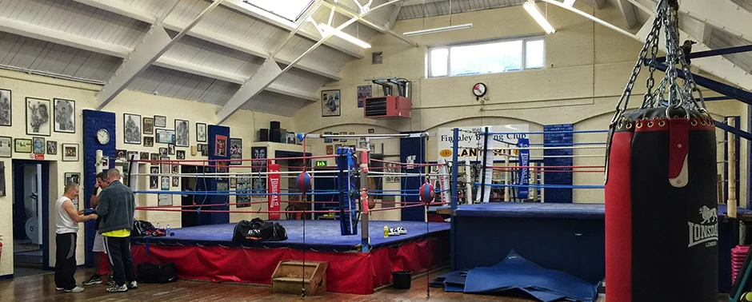

## Group Workshops &amp; 1-to-1 Private Sessions

We offer a range of group classes and workshops for both adults and children, alongside private 1-to-1 coaching tailored to your schedule.

For 1-to-1 sessions, bespoke executive timings, or more information before attending your first class, please call **Gary Foley** directly on **[07749 116927](tel:+447749116927)** or **Sean Murphy** on **[07729 980677](tel:+447729980677)**.

## Weekly Training Schedule (Anchor Hall, Barnet)

All group sessions and private 1-to-1 bookings take place at **Anchor Hall, Bulwer Rd, Barnet, London EN5 5EX**. Please call ahead before your first visit so we can confirm availability and prepare your equipment.

| Day | Morning / Daytime (07:00 – 17:30) | Evening Sessions (18:00 – 21:00) | Session Focus |
| :--- | :--- | :--- | :--- |
| **Monday** | 1-to-1 Private Coaching (By Appointment) | 18:30 – 20:00 Adult White Collar Fundamentals | Stance, footwork, jab-cross mechanics, and bag conditioning. |
| **Tuesday** | 1-to-1 Private Coaching (By Appointment) | 17:30 – 18:30 Youth Boxing · 18:45 – 20:15 Amateur &amp; Fight Camp | Combination punching, defensive drills, and pad rounds. |
| **Wednesday** | 1-to-1 Private Coaching (By Appointment) | 18:30 – 20:00 Boxing Conditioning &amp; Technical Workshop | High-intensity intervals, core endurance, and ring craft. |
| **Thursday** | 1-to-1 Private Coaching (By Appointment) | 17:30 – 18:30 Youth Boxing · 18:45 – 20:15 Supervised Sparring &amp; Pads | Controlled technical sparring (optional) and tactical mitts. |
| **Friday** | 1-to-1 Private Coaching (By Appointment) | 18:00 – 19:30 Open Gym &amp; Fight Camp Rounds | Championship rounds, recovery mobility, and corner review. |
| **Saturday** | 09:30 – 11:00 Weekend White Collar Workshop | 11:00 – 15:00 1-to-1 Private Coaching | All-levels technique, pad work, and weekend conditioning. |
| **Sunday** | Private Fight Camp Prep (By Arrangement) | Rest &amp; Recovery | Individual bout preparation prior to scheduled fight nights. |

## What to Bring to Your First Session

1. **Hand Wraps &amp; Gloves**: We recommend 180-inch cotton/elasticated hand wraps and 16oz sparring/training gloves. Loan gloves are available for your introductory session when booked in advance.
2. **Footwear &amp; Clothing**: Clean indoor training shoes or boxing boots, breathable sportswear, a towel, and a 1-litre water bottle.
3. **Mouthguard &amp; Headgear**: Required only when progressing to supervised technical sparring in the Amateur and Advanced tiers.

## Reserve Your Spot

Call **[07749 116927](tel:+447749116927)** today to book your introductory 1-to-1 assessment or reserve a place in this week's Barnet classes.
