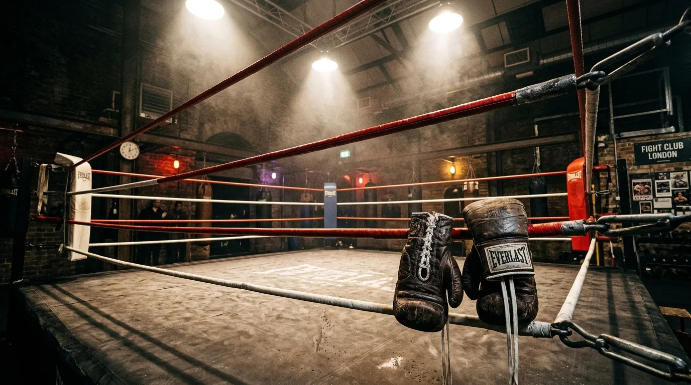
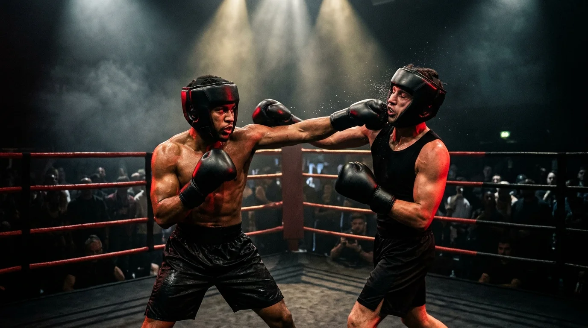
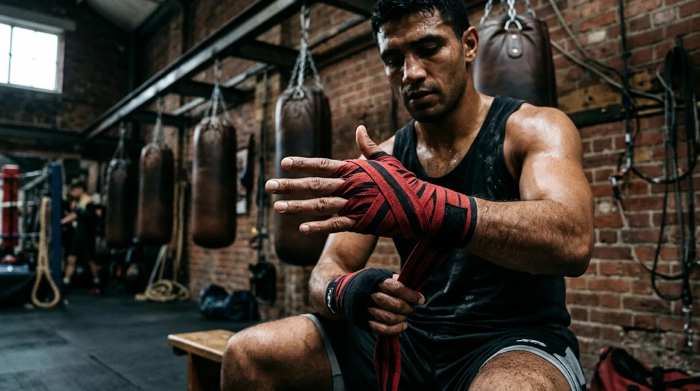
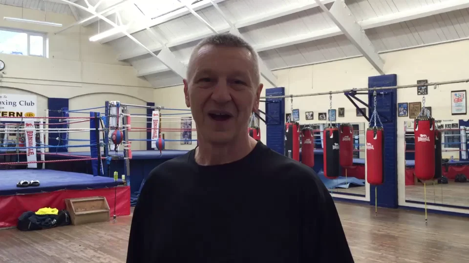
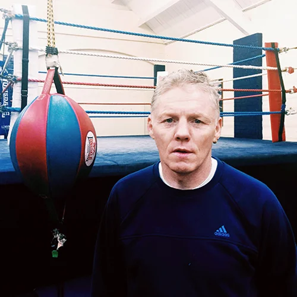

<section class="visage-intro" aria-label="Championship Boxing Club Introduction">
  

    

      LIVE ARENA · ANCHOR HALL, BARNET EN5 5EX · IWCBA ALIGNED
      <h1>Step Through The Ropes. <em>Release Your Inner Athlete.</em></h1>
      
Experience authentic London white collar boxing coaching alongside Head Coach Gary Foley (20+ years ringside) and Commonwealth Games Gold Medallist &amp; Outright British Lonsdale Belt winner Sean Murphy. Train 1-to-1 for elite non-contact executive fitness, or complete a structured 8-to-12-week fight camp for your charity bout under the arena lights.

      

        <a class="primary" href="/get-in-touch/index.html">Book 1-to-1 Assessment</a>
        <a class="secondary-btn" href="tel:+447749116927">Call Gary: 07749 116927</a>
      

      <ul class="hero-assurances" aria-label="Key training guarantees">
        <li>20+ Years London White Collar Boxing Pedigree</li>
        <li>Commonwealth Gold &amp; Outright Lonsdale Belt Tuition</li>
        <li>100% Optional Sparring · Beginner to Contender</li>
        <li>1-to-1 Padwork &amp; Fight Camps in Barnet (EN5 5EX)</li>
      </ul>
    

    

      

        <strong>FIGHTSPHERE TELEMETRY · BARNET ARENA (EN5 5EX)</strong>
        
Private 1-to-1 Executive Padwork &amp; 12-Week Charity Fight Camps led by Gary Foley &amp; Commonwealth Gold Medallist Sean Murphy.

      

    

  

</section>

<section class="trust-strip" aria-label="Coaching credentials and gym summary">
  

    <ul>
      <li>
        <b>20+ Years Ringside</b>
        Over two decades preparing London executives, founders, and first-time contenders for the ring.
      </li>
      <li>
        <b>Commonwealth Gold</b>
        Direct technical tuition from Sean Murphy — Commonwealth Games Gold Medallist &amp; Lonsdale Belt winner.
      </li>
      <li>
        <b>3 Progressive Tiers</b>
        Structured Basic, Amateur, and Advanced fight camps aligned with International White Collar Boxing standards.
      </li>
      <li>
        <b>Barnet Gym · EN5 5EX</b>
        Dedicated North London facility at Anchor Hall, Bulwer Rd (High Barnet Northern Line). Call 07749 116927.
      </li>
    </ul>
  

</section>

<section class="analysis-stage" aria-labelledby="hero-stage-heading">
  

    

      
      

        
Inside Anchor Hall · Barnet, North London

        <h2 id="hero-stage-heading">Train in a real fighters' gym — zero ego, championship standards</h2>
        
Whether you are walking into a boxing gym for the very first time or sharpening your combinations for a black-tie charity show, every session at Anchor Hall is engineered around technical precision, defensive composure, and personal safety.

        

          
Watch Coach Gary Foley's Original Barnet Gym Briefing (Video)

          <video controls preload="none" poster="/images/boxing/hero-arena.webp" width="960" height="540" aria-label="Head Coach Gary Foley inside the Barnet boxing gym">
            <source src="/videos/gary.mp4" type="video/mp4" />
            <source src="/videos/gary.ogv" type="video/ogg" />
            Your browser does not support HTML5 video. Call Gary Foley directly on 07749 116927.
          </video>
        

        

          <a class="primary" href="tel:+447749116927">Call Gary: 07749 116927</a>
          <a class="secondary-btn" href="tel:+447729980677">Call Sean: 07729 980677</a>
        

      

    

    

      

        
Mode 01 · Non-Contact Executive Conditioning

        <h3>Train for Fitness, Skill &amp; Mental Sharpness</h3>
        
Around half of our members never step into a public bout. You get the exact same championship padwork, footwork drills, heavy-bag intervals, and metabolic conditioning as a professional fighter — with zero head contact and zero pressure to spar.

      

      

        
Mode 02 · 8–12 Week Charity &amp; White Collar Bout

        <h3>Train to Compete Under the Arena Lights</h3>
        
Preparing for a corporate gala or charity fight night in London? We take you from complete novice to composed contender over 8 to 12 weeks, managing your technical defence, ring generalship, weight cut, medical readiness, and ringside cornering on fight night.

      

      

        
      

    

  

</section>

<section class="visage-features" aria-labelledby="programmes-heading">
  

    

      
Three Skill Levels · Basic, Amateur &amp; Advanced

      <h2 id="programmes-heading">Structured coaching for every stage of your boxing journey</h2>
      
Every boxer begins with a 1-to-1 baseline assessment at Anchor Hall so we can match your fitness, coordination, and goals to the right tier.

    

    

      <article>
        
        

          Tier 01 · The Novice (Foundation)
          <h3>Basic / Beginner Boxing</h3>
          
Built for complete newcomers with zero prior ring experience. Master balanced stance, footwork, high-guard defence, crisp straight punches, and boxing conditioning without unscheduled contact.

          <ul>
            <li>Orthodox &amp; southpaw stance biomechanics</li>
            <li>6 × 2-minute technical pad &amp; heavy-bag rounds</li>
            <li>100% non-contact — ideal for executive fitness</li>
          </ul>
        

      </article>
      <article>
        
        

          Tier 02 · The Contender (Intermediate)
          <h3>Amateur / Mid-Level Camp</h3>
          
Designed for boxers preparing for their first white collar or charity bout. Develop multi-punch combinations, slip-and-counter mechanics, ring craft, and closely supervised technical sparring.

          <ul>
            <li>3-to-5 punch combination flow &amp; head movement</li>
            <li>Supervised 16oz glove &amp; headguard technical sparring</li>
            <li>3 × 2-minute bout pacing &amp; anaerobic conditioning</li>
          </ul>
        

      </article>
      <article>
        
        

          Tier 03 · The Main Event (Ringside)
          <h3>Advanced Fight Camp</h3>
          
High-intensity 8-to-12-week fight camp periodisation for experienced white collar contenders. Includes tactical game planning, championship rounds on the pads, and full corner support on fight night.

          <ul>
            <li>8 to 10 championship rounds per session</li>
            <li>Opponent style analysis &amp; weight management</li>
            <li>Full ringside warm-up &amp; cornering on fight night</li>
          </ul>
        

      </article>
    

  

</section>

<section class="visage-process" aria-labelledby="process-heading">
  

    
12-Week Executive Fight Camp Blueprint

    <h2 id="process-heading">From first hand-wrap to the final bell in four phases</h2>
    

      <article>
        <b>Weeks 01–03</b>
        <h3>Stance, Guard &amp; Engine</h3>
        
Baseline fitness assessment at Anchor Hall, hand-wrapping clinic, balanced footwork, tight defensive shell, and aerobic base building on the heavy bags.

      </article>
      <article>
        <b>Weeks 04–06</b>
        <h3>Combinations &amp; Defence</h3>
        
High-velocity 1-to-1 padwork with Gary Foley and Sean Murphy. Parries, slips, roll-and-counters, inside work, and lactic-threshold interval circuits.

      </article>
      <article>
        <b>Weeks 07–10</b>
        <h3>Ring Craft &amp; Sparring</h3>
        
Controlled, coach-refereed technical sparring in full 16oz gloves and headguards. Learn to manage adrenaline, cut off the ring, and breathe under pressure.

      </article>
      <article>
        <b>Weeks 11–12</b>
        <h3>Taper &amp; Fight Night</h3>
        
Sharpness pad rounds, nutritional taper, medical and weight check, dressing-room warm-up, and veteran tactical instructions in your corner between rounds.

      </article>
    

  

</section>

<section class="visage-specialists" aria-labelledby="trainers-heading">
  

    <header class="section-heading">
      
Meet Your Coaches

      <h2 id="trainers-heading">Proven British &amp; Commonwealth boxing pedigree</h2>
      
Train directly with seasoned professionals who have competed and coached at the highest levels of British and international boxing.

    </header>
    

      <article>
        

          
          

            
Head White Collar Boxing Coach

            <h3>Gary Foley</h3>
          

        

        <ul class="badge-row" aria-label="Gary Foley credentials">
          <li>20+ Yrs London WCB</li>
          <li>9+ Yrs Qualified Trainer</li>
          <li>UK Competitive Boxer</li>
        </ul>
        
Gary has over 20 years of hands-on experience with white collar boxing in London and has been a qualified boxing trainer for over 9 years, alongside competing across the UK. He specialises in transforming first-time executives into calm, technically sound contenders.

        

          <a class="primary" href="tel:+447749116927">Call Gary: 07749 116927</a>
          <a class="secondary-btn" href="/trainers/index.html">Coach Profile</a>
        

      </article>
      <article>
        

          
          

            
Senior Championship Coach

            <h3>Sean Murphy</h3>
          

        

        <ul class="badge-row" aria-label="Sean Murphy championship honours">
          <li>Commonwealth Games Gold</li>
          <li>British Lonsdale Belt Outright</li>
          <li>World Title Contender</li>
        </ul>
        
Sean brings decades of elite championship boxing and conditioning expertise. Having won a Commonwealth Games Gold Medal, captured the British Lonsdale Belt outright, and boxed for a World Title, Sean teaches authentic championship ring craft and precision padwork.

        

          <a class="primary" href="tel:+447729980677">Call Sean: 07729 980677</a>
          <a class="secondary-btn" href="/trainers/index.html">Coach Profile</a>
        

      </article>
    

  

</section>

<section class="visage-faq" aria-labelledby="home-faq-heading">
  

    

      
Common Questions

      <h2 id="home-faq-heading">Everything you need to know before your first session</h2>
      
Have a specific question about charity fight camps, safety rules, or 1-to-1 availability? Visit our <a href="/faqs/index.html">full FAQ</a> or call <a href="tel:+447749116927">07749 116927</a>.

    

    

      

        
What is White Collar Boxing?

        
White collar boxing is a form of boxing in which men and women in white-collar professions train to fight at special events, often for charity. Most participants have no prior boxing experience before starting their structured training camp.

      

      

        
Do I have to spar or compete in a bout to train with you?

        
No. Many of our clients train purely for elite cardiovascular fitness, stress relief, weight loss, and technical skill mastery through 1-to-1 pad work and non-contact group conditioning.

      

      

        
How is safety managed during sparring and fight camps?

        
Safety is paramount and aligned with International White Collar Boxing Association (IWCBA) principles. All sparring is strictly optional, uses 16oz padded gloves, fitted mouthguards, headguards, and groin protectors, and is supervised round-by-round in the ring by Gary Foley or Sean Murphy.

      

      

        
Where is the gym located in London?

        
Our gym is located at Anchor Hall, Bulwer Rd, Barnet, London EN5 5EX, within easy reach of High Barnet (Northern Line) and New Barnet National Rail station, with convenient local parking.

      

    

  

</section>

<section class="visage-closing" aria-labelledby="closing-heading">
  

    

      
Step Into The Ring

      <h2 id="closing-heading">Ready to start your 1-to-1 assessment or 12-week fight camp in Barnet?</h2>
    

    

      
Speak directly with Head Coach Gary Foley on <strong>07749 116927</strong> or Senior Coach Sean Murphy on <strong>07729 980677</strong> to book your first session at Anchor Hall, Bulwer Rd, Barnet EN5 5EX.

      

        <a class="primary" href="/get-in-touch/index.html">Book Assessment Now</a>
        <a class="secondary-btn" href="tel:+447749116927">Call 07749 116927</a>
      

    

  

</section>
