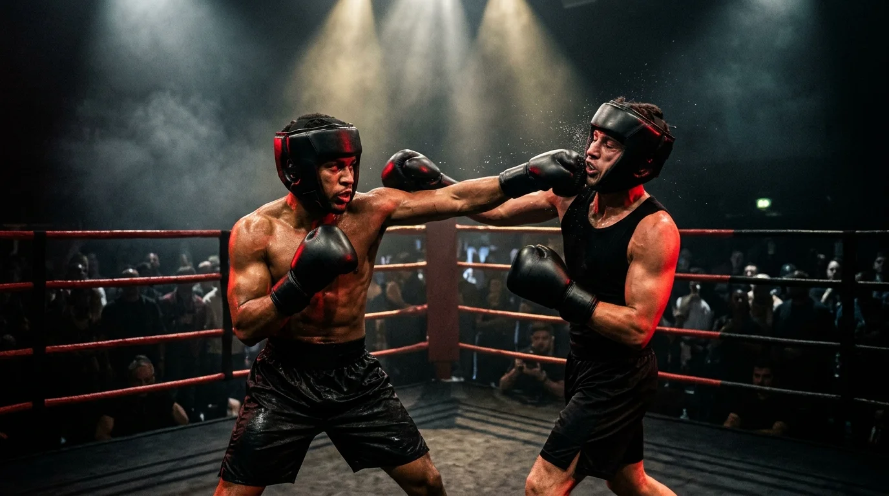
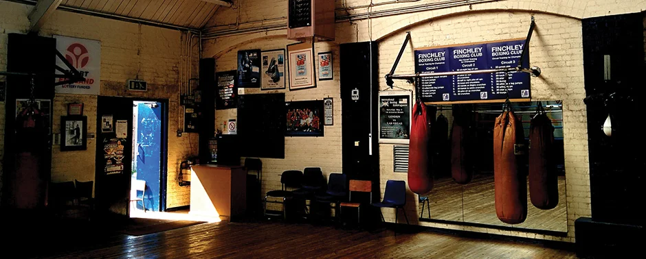

## From Gleason's Gym in Brooklyn to London's Executive Rings

**White collar boxing** is a form of boxing in which men and women in white-collar professions train to fight at special events. Most have had no prior boxing experience before stepping onto the gym floor.

### 1988: The Birth of White Collar Boxing in New York

The movement began at the legendary **Gleason's Gym** in New York City in **1988**, when gym owner **Bruce Silverglade** paired two recreational executive members — **Richard Novak**, an attorney, and **Joelarden** / fellow PhD and corporate professionals — for a supervised, three-round exhibition bout. What started as a monthly Friday-night tradition for Wall Street bankers, doctors, lawyers, and media executives rapidly evolved into an international phenomenon.

### The Rise of London Executive & Charity Fight Nights

By the early 2000s, white collar boxing had established a permanent home in **London** and across the **United Kingdom**. In the City of London, Canary Wharf, and North London, professionals discovered that preparing for a three-round boxing match delivered a physical and psychological transformation that no ordinary health club or treadmill could replicate.

At the same time, charity gala fight nights transformed white collar bouts into prestigious black-tie fundraising evenings, raising millions of pounds for UK charities while giving everyday professionals the unforgettable experience of walking out to their chosen entrance track under arena lights.

### Safety, Governance & The International White Collar Boxing Association

As the sport grew globally, formal safety and matchmaking standards became essential. Aligned with the **International White Collar Boxing Association (IWCBA)** and modern UK amateur/white-collar safety protocols, legitimate white collar boxing enforces:

- **Fair Matchmaking**: Opponents are paired strictly by weight class, age bracket, fitness baseline, and total hours of ring experience.
- **Protective Equipment**: Mandatory `16oz` competition gloves, fitted headguards, gumshields, and groin protectors.
- **Medical Oversight**: Pre-bout medical screening and ringside doctors/paramedics at every sanctioned show.
- **3 × 2-Minute Rounds**: High-tempo, controlled round durations with a standing eight-count and safety-first refereeing.

### Our Mission at Anchor Hall, Barnet (EN5 5EX)

Founded on over **20 years of London white collar boxing experience**, our gym at **Anchor Hall, Bulwer Rd, Barnet, London EN5 5EX** brings together Head Coach **Gary Foley** and Commonwealth Games Gold Medallist & Outright British Lonsdale Belt winner **Sean Murphy**. We exist to ensure that every executive, founder, and newcomer who steps through the ropes does so with authentic British boxing technique, supreme conditioning, and unshakeable self-belief.

Ready to write your own chapter? [Explore what's involved in our 3-tier fight camps](/whats-involved/index.html) or [book your 1-to-1 assessment today](/get-in-touch/index.html).
