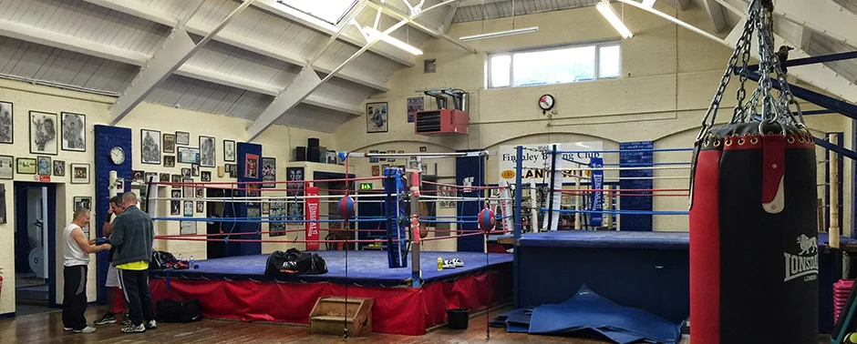
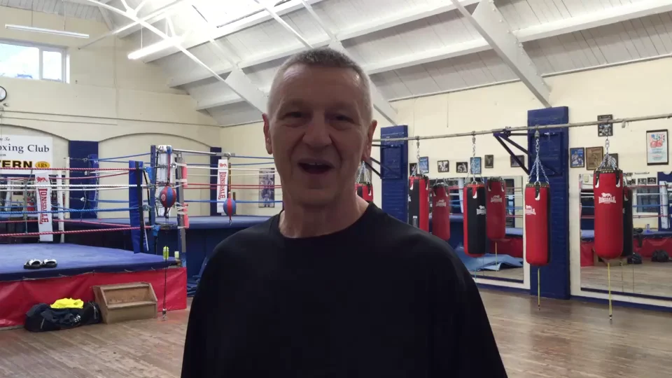
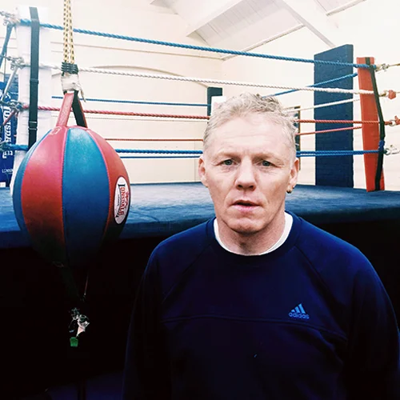

## Championship Pedigree. Personal Mentorship.

When you step into the ring at **Anchor Hall, Barnet, London EN5 5EX**, you are never handed off to a generic fitness instructor. Every 1-to-1 pad session, group class, and 12-week fight camp is coached personally by **Gary Foley** and **Sean Murphy** — two veterans with decades of proven British, Commonwealth, and international boxing pedigree.

---

## Gary Foley — Head White Collar Boxing Coach

  <article>
    

      
      

        
Head White Collar Boxing Coach

        <h3>Gary Foley</h3>
      

    

    <ul class="badge-row">
      <li>20+ Years London WCB Experience</li>
      <li>9+ Years Qualified Trainer</li>
      <li>UK White Collar Competitor</li>
    </ul>
    
Gary has over 20 years of direct experience with white collar boxing in London and has been a qualified boxing trainer for over 9 years, alongside competing across the UK. Having walked the exact path his clients take — balancing professional commitments with disciplined fight preparation — Gary specialises in taking complete novices and turning them into composed, technically sharp boxers.

    
<strong>Direct Coaching Line:</strong> <a href="tel:+447749116927">07749 116927</a> (`+44 7749 116927`)

  </article>

  <article>
    

      
      

        
Senior Championship Coach

        <h3>Sean Murphy</h3>
      

    

    <ul class="badge-row">
      <li>Commonwealth Games Gold Medallist</li>
      <li>British Lonsdale Belt Outright</li>
      <li>World Title Contender</li>
    </ul>
    
Sean brings decades of elite championship boxing and physical conditioning mastery to Anchor Hall. During his distinguished career, Sean won a <strong>Commonwealth Games Gold Medal</strong>, captured the prestigious <strong>British Lonsdale Belt outright</strong>, and boxed for a <strong>World Title</strong>. His 1-to-1 pad work teaches executive contenders authentic championship leverage, defensive subtlety, and ring generalship.

    
<strong>Direct Coaching Line:</strong> <a href="tel:+447729980677">07729 980677</a> (`+44 7729 980677`)

  </article>

---

## Watch Head Coach Gary Foley at Anchor Hall

<video controls preload="metadata" poster="/images/banner/banner_4.webp" width="960" height="540">
  <source src="/videos/gary.mp4" type="video/mp4" />
  <source src="/videos/gary.ogv" type="video/ogg" />
  Your browser does not support HTML5 video.
</video>

---

## Coaching Comparison & Specialties

| Coach | Key Credentials | Coaching Specialties | Direct Telephone |
| :--- | :--- | :--- | :--- |
| **Gary Foley** | 20+ yrs London WCB experience · 9+ yrs qualified trainer · UK competitor | First-time white collar onboarding, 12-week fight camp scheduling, defensive composure, charity bout cornering | [07749 116927](tel:+447749116927) |
| **Sean Murphy** | Commonwealth Games Gold Medallist · British Lonsdale Belt Outright Winner · World Title Contender | Championship pad work, counter-punching biomechanics, ring generalship, elite metabolic conditioning | [07729 980677](tel:+447729980677) |

Ready to book a 1-to-1 session with Gary or Sean? [Visit our booking and directions page](/get-in-touch/index.html) or call directly today.
