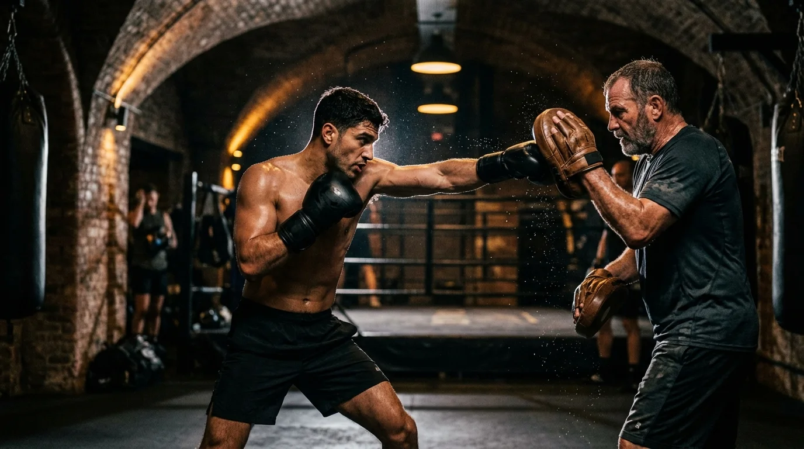
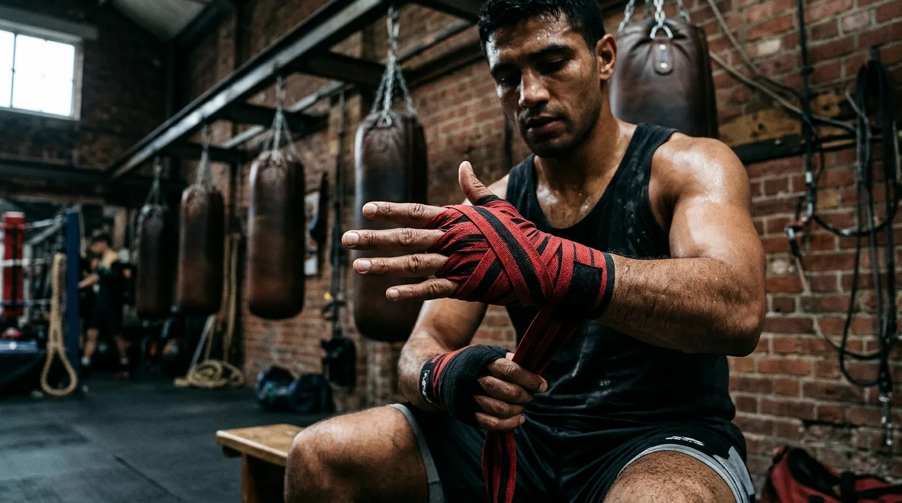

## Three Progressive Tiers of White Collar Boxing Coaching

Every contender who walks through the doors at **Anchor Hall, Barnet (EN5 5EX)** brings a different athletic background, schedule, and goal. Whether you are training purely for executive stress relief and peak cardiovascular fitness or preparing for an 8-to-12-week charity bout in front of 500 guests, our curriculum is structured into three progressive tiers.

### Tier 1: Basic / Beginner Boxing Training (The Novice)

Designed for complete newcomers with zero prior boxing or combat sports experience.

- **Technical Focus**: Balanced orthodox and southpaw stance, guard discipline, distance management, footwork pivots, and crisp straight punches (`jab` and `cross`) plus foundational hooks.
- **Conditioning**: Boxing-specific skipping, shadow-boxing rounds, heavy-bag combinations, and core stability circuits.
- **Contact Policy**: **100% non-contact**. You work exclusively on the focus mitts with Gary Foley or Sean Murphy and on the leather heavy bags.

### Tier 2: Amateur / Mid-Level Boxing Training (The Contender)

Built for intermediate boxers and professionals preparing for their first regulated white collar or charity boxing match.

- **Technical Focus**: Multi-punch combinations (3 to 5 punch sequences), defensive head movement (slips, rolls, pull-counters), parrying, and ring cutting.
- **Conditioning**: High-intensity 2-minute and 3-minute interval rounds engineered to replicate the anaerobic demands of a 3 × 2-minute white collar bout.
- **Contact Policy**: Optional, closely refereed technical drills and progressive sparring in full protective equipment (`16oz` sparring gloves, cheek-protector headguard, custom gumshield, and groin guard).

### Tier 3: Advanced Competitive Fight Camp (The Main Event)

Tailored for experienced white collar boxers and returning contenders targeting high-profile London gala shows.

- **Technical Focus**: Advanced counter-punching, rhythm manipulation, inside fighting, southpaw/orthodox tactical adjustments, and opponent-specific game plans.
- **Conditioning**: 8-to-12-week periodised fight camp covering strength, explosive power, weight management, and 8-to-10 championship rounds per session.
- **Fight Night Support**: Full dressing-room hand wrapping, warm-up pad work, and experienced ringside cornering from Gary Foley and Sean Murphy.

---

## Tier Comparison Matrix

| Training Dimension | Tier 01: Basic / Beginner | Tier 02: Amateur / Mid-Level | Tier 03: Advanced Fight Camp |
| :--- | :--- | :--- | :--- |
| **Prior Experience Required** | None (Complete Beginners) | 4+ weeks foundational boxing | Previous bout or advanced camp |
| **Round Structure** | 6 × 2-minute technical rounds | 8 × 2-minute high-pace rounds | 10 × 3-minute championship rounds |
| **1-to-1 Pad Work** | Foundational mechanics & defence | Combination flow & counter-punching | Tactical fight-night simulation |
| **Sparring & Contact** | Non-contact (Pads & Heavy Bags) | Controlled technical sparring (16oz) | Full refereed fight-camp sparring |
| **Target Outcome** | Executive fitness, fat loss & skill | First charity / white collar bout | Main-event white collar competition |

---

## Mandatory Equipment & Safety Governance

We adhere strictly to **International White Collar Boxing Association (IWCBA)** safety principles:

1. **Hand Protection**: Every boxer must wear 4.5-metre cotton hand wraps under properly weighted leather gloves (`14oz` to `16oz` for bag and pad work; strictly `16oz` for any sparring).
2. **Protective Gear for Sparring**: Fitted boil-and-bite or custom dentist gumshield, padded headguard, and groin protector are mandatory before stepping through the ropes for contact drills.
3. **Coach Matchmaking**: Sparring partners are matched strictly by weight, reach, technical control, and temperament — never thrown in unmanaged.

Ready to discover which tier fits your current baseline? [Book your 1-to-1 assessment in Barnet](/get-in-touch/index.html) or call Gary Foley directly on **07749 116927**.
